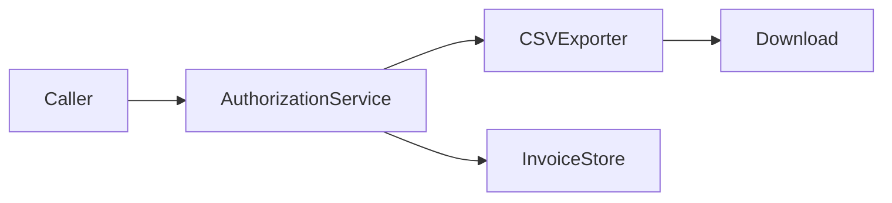

# Invoice export boundary

The service checks the authenticated customer against the invoice owner before
calling the exporter. The exporter only formats authorized data. No UI changes,
provider API, persistence migration or payment processing belongs to this task.

| Data layer | Owner | Lifetime |
| --- | --- | --- |
| Customer identity | Calling adapter | One request |
| Invoice identity, owner and amount | Invoice store | Existing record |
| Authorized invoice | Service | One request |
| CSV bytes | Exporter | Download response |

This isolated headless example uses in-memory fixture invoices. Architecture
reuses the existing service/formatter split; no new Workbench or ADR is needed.
